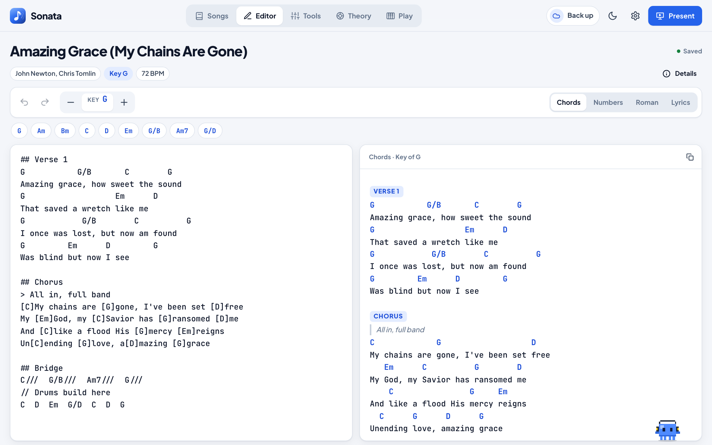
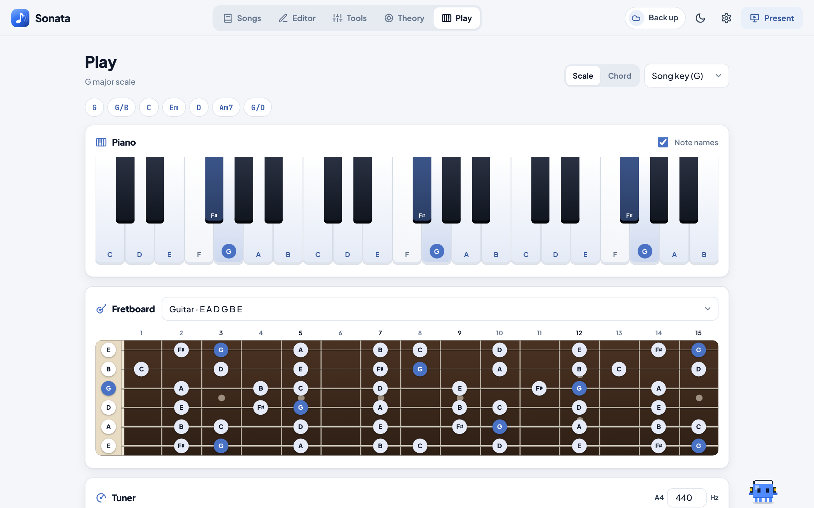
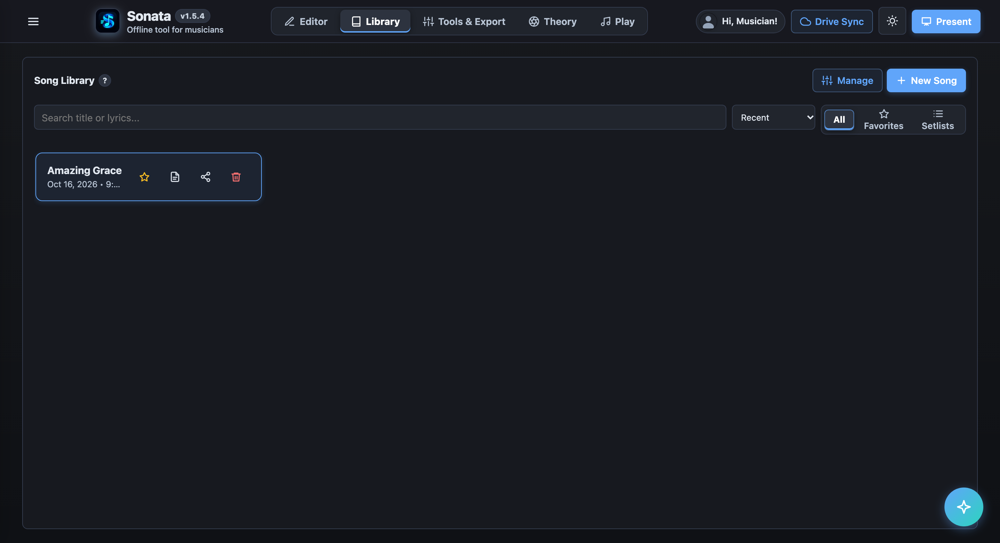
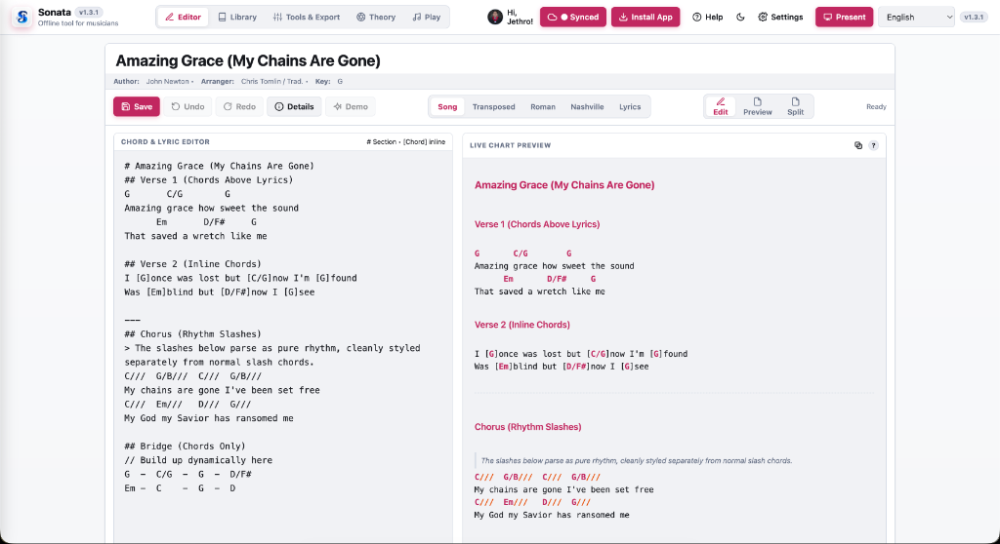
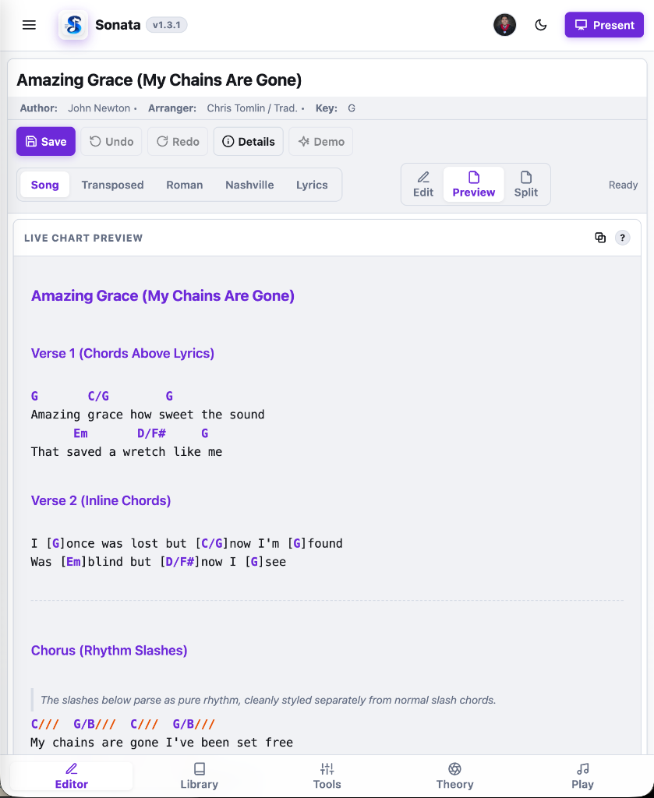
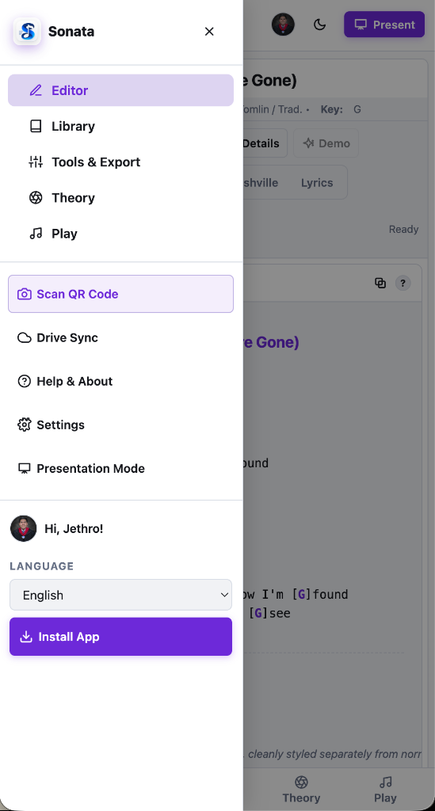
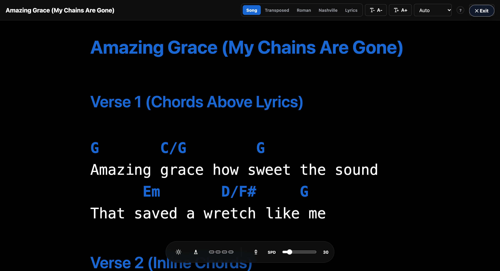

# Sonata 🎵

> **The modern, distraction-free chord chart editor and musical toolkit for musicians, bands, and worship teams.**

[](https://jethfrane-sonata.vercel.app)
[](#)
[](#)
[](#)

---

## 🌐 Live Web App

* **Production URL:** [https://jethfrane-sonata.vercel.app](https://jethfrane-sonata.vercel.app)

Sonata runs entirely in your web browser. No software installation or account creation is required—simply open the link and start making music.

---

## 📸 Interface Showcase

| 📝 Split Editor (Light Mode) | 🎹 Virtual Piano, Fretboard & Tuner |
| :---: | :---: |
|  |  |

| 📚 Song Library (Dark Mode) | 🎨 Custom Themes & Accents |
| :---: | :---: |
|  |  |

| 📱 Mobile-First Live Preview | 📑 Slide-Out Drawer Navigation | 🎭 Stage Presentation Mode |
| :---: | :---: | :---: |
|  |  |  |

---

## 🌟 Overview

Created by **Jeth Frane**, Sonata was built to replace clumsy paper binders, cluttered PDF viewers, and expensive subscription chart apps. It combines a fast, intuitive chord sheet markdown editor with interactive musical tools, instant team sharing, and stage-ready presentation modes.

### Why Musicians Love Sonata:
* 🆓 **100% Free Forever:** No paywalls, trial periods, or monthly subscriptions.
* 🔒 **Private & Decentralized:** Your song charts belong to you. Data is stored on your device and backed up directly to your personal Google Drive. No centralized databases or user tracking.
* 🛡️ **Zero Data Loss Protection:** Intelligent Unsaved Changes Guard warns you before navigating away or closing tabs, offering quick *Save & Leave*, *Discard*, or *Cancel*.
* ⚡ **Stage-Ready:** Distraction-free fullscreen presentation mode with smooth auto-scroll, customizable metronome, floating auto-fading exit controls, and true-black stage theme.
* 🤖 **AI Co‑Writer Built-in:** Real‑time music suggestions, chord generation, and UI automation (change keys, themes, and tempo) directly via chat. Includes a smart "Undo" feature for safe UI automation, Reply quotes for token efficiency, and Bring-Your-Own-Key (BYOK) support for unlimited free usage.
* 📱 **Universal Responsiveness:** Adaptive layout designed for all screens—smartphones, tablets, laptops, and ultra-wide desktop displays—with seamless slide-out drawer navigation on screens under 1024px.
* ♿ **Accessibility First (WCAG AA):** Clear focus outlines, high-contrast dark mode tabs, comprehensive ARIA labels across all icon buttons, and 44px touch targets on stage and metronome controls.

---

## 🚀 Key Features

### 1. 📝 Chord & Lyric Editor
* **Dual Format Support:** Works with both traditional chord lines (`G  C/G  D`) and inline bracket chords (`[G]Amazing [C]grace`).
* **Clean Markdown Syntax:**
  * `# Title` – Sets song title
  * `## Section` – Creates section headers (`Verse 1`, `Chorus`, `Bridge`)
  * `---` – Inserts a clean visual divider
  * `> Note` or `// Comment` – Adds rehearsal notes that never transpose accidentally
* **Live Transposition & Capo:** Transpose semitones up/down instantly with slider or mobile stepper buttons (`- [ 0 ] +`), automatic enharmonic spelling (Flats/Sharps toggle), and capo calculations.
* **Notation Formats:** Switch between Standard Chords, Roman Numeral Analysis, and Nashville Number System.
* **Undo & Redo History:** 50-step history stack tracking text edits and chord transpositions with standard keyboard shortcuts (`⌘Z` / `Ctrl+Z` and `⌘⇧Z` / `Ctrl+Y`).
* **Unsaved Changes Guard:** Never lose edits accidentally. Sonata prompts with a custom 3-button modal (`Save & Leave`, `Discard`, `Cancel`) when switching views and activates browser `beforeunload` protection.

### 2. 📚 Song Library & Setlist Manager
* **Fast Search & Filtering:** Filter by song key, artist, or tags with instant search.
* **Multi-Song Setlists:** Create custom worship sets and gig setlists. Cycle through songs with one click or arrow keys on stage.
* **Destructive Action Safety:** Confirmation dialogs protect against accidental song deletion, demo overwrites, or chart clearing.
* **Quick Import & Export:** Export your entire song library as JSON backups and restore on any device.

### 3. 🎹 Music Theory & Interactive Tools
* **Interactive Circle of Fifths:** Click any key to hear 3-note harmonic audio synthesis. Toggle auto-rotate and highlight diatonic key families in real time.
* **Virtual Piano Keyboard:** Multi-octave digital piano with sustain release and scale chord highlighting.
* **Interactive Fretboards:** Visualization for 6-String Guitar, 4-String Bass, 5-String Bass, and Ukulele.
* **Digital Chromatic Tuner & Pitch Reference:** Built-in microphone tuner with visual pitch cents needle and audio tone generator.
* **Visual & Audio Metronome:** Tap tempo, adjustable BPM (30–280), custom time signatures (2/4, 3/4, 4/4, 6/8), flashing beat dots, and 44px touch targets.

### 4. 🎭 Stage Presentation Mode
* **Immersive Fullscreen:** Strips away distractions for maximum legibility on music stands.
* **Floating Exit Button:** Sleek, accessible exit button floating in the top-right corner that automatically fades out during idle performance and reappears on interaction.
* **Hands-Free Auto-Scroll:** Adjustable smooth scrolling with variable speed controls (`Space` to toggle, `Up`/`Down` arrows to adjust speed).
* **Stage Display Themes:** Switch between High-Contrast Light, Studio Dark, and OLED Stage True-Black.

### 5. 📤 Zero-Friction Sharing & Exports
* **Scannable QR Codes:** Share songs directly between band members' phones via dynamic QR codes.
* **Compressed Share Links:** Generate compact direct links containing full song charts without requiring an account.
* **Multi-Column Vector PDF & PNG:** Export beautifully formatted printable sheets with your team's custom logo.

### 6. ☁️ Google Drive Cloud Backup
* **Direct Cloud Sync:** Automatically syncs your library file (`sonata_library.json`) to your personal Google Drive in the background.
* **Cross-Device Status Indicators:** Real-time Google account sync status pill in both desktop topbar and mobile navigation drawer.

---

## ⌨️ Keyboard Shortcuts Reference

| Shortcut (Mac) | Shortcut (Win / Linux) | Action | Context |
| :--- | :--- | :--- | :--- |
| `⌘ + S` | `Ctrl + S` | Save current song | Editor |
| `⌘ + Z` | `Ctrl + Z` | Undo edit or transpose | Editor |
| `⌘ + Shift + Z` | `Ctrl + Y` | Redo edit or transpose | Editor |
| `Space` | `Space` | Start / Pause auto-scroll | Presentation Mode |
| `↑` / `↓` | `↑` / `↓` | Increase / decrease auto-scroll speed | Presentation Mode |
| `[` / `]` | `[` / `]` | Decrease / increase font size | Presentation Mode |
| `Esc` | `Esc` | Exit presentation mode / close modals | Everywhere |

---

## 🛠️ Technology Stack

* **Frontend Architecture:** Vanilla HTML5, Modern CSS3 (Glassmorphism, CSS Grid, Flexbox), Vanilla ES6+ JavaScript.
* **Audio Synthesis:** Web Audio API (polyphonic synth, resonant filters, sample-accurate metronome scheduling).
* **PDF & Graphics:** html2pdf.js, QRCode.js, Lucide SVG Icons.
* **Hosting & CI/CD:** [Vercel](https://vercel.com) (Edge CDN, Serverless AI Backend, Automated Deployments).

---

## 📦 Release History

- **v1.5.0 (2026-09-11)**:
  - **Desktop & Laptop Full Viewport IDE:** Full 100% viewport split editor eliminating empty space, with independent internal scrolling and custom thin scrollbars.
  - **Responsive Layout:** Tablet & mobile navigation collapse under 1024px into a slide-out drawer, with a dedicated mobile Google Sync status pill.
  - **Interactive Syntax Quick-Start:** Clickable syntax chips in empty editor to quickly insert headers, chords, dividers, and rehearsal notes with real-time preview.
  - **Metadata Chips & Live Status Dot:** Replaced plain text author/arranger/key bar with sleek metadata chips, plus a live indicator dot reflecting Saved (green), Autosaving (pulsing blue), and Editing (amber).
  - **Chart Preview Polish:** Fixed text wrapping on chart empty state and added modern SVG music illustrations.
  - **Destructive Action Confirmations:** Safe modal dialogs before deleting songs, loading demos, or clearing unsaved charts.
  - **Unsaved Changes Guard:** Browser `beforeunload` warning and in-app navigation dialog (*Save & Leave*, *Discard*, *Cancel*) preventing accidental loss of work.
  - **Toast Notification System:** Modern, non-blocking bottom-center toast alerts for save, cloud sync, export, transposition, and song deletion.
  - **Stage Presentation Polish:** Floating, high-visibility "Exit Presentation" button with 3-second auto-fade, plus keyboard shortcut hints.
  - **Mobile Transpose Stepper:** Intuitive minus/plus stepper controls for mobile screens alongside the transpose slider.
  - **Accessibility & Contrast (WCAG AA):** High-contrast active tab styling in dark mode, visible keyboard focus rings, descriptive ARIA labels across all icon buttons, and 44px minimum touch targets on metronome controls.
  - **Transpose Undo Stack:** Integrated chord transposition into the 50-step undo/redo history stack.
  - **Cross-Platform Shortcut Hints:** Dynamically detects macOS (`⌘S`, `⌘Z`) vs Windows/Linux (`Ctrl+S`, `Ctrl+Z`) for keyboard shortcuts, with a global Cmd/Ctrl+S save listener.
- **v1.4.1 (2026-08-26)**:
  - AI Action UI: Actions securely execute UI commands with a new "Undo" functionality.
  - Inline UI Confirmations: Safely clear AI chat history without disruptive browser popups.
  - Smarter Gemini: AI Co-Writer perfectly understands all Sonata app features, settings, and navigation.
  - AI UX Polish: Modern Bot icon and settings bugfixes.
- **v1.4.0 (2026-08-26)**:
  - AI Co-Writer: Generate chords, format lyrics, and automate the UI directly via chat.
  - Bring Your Own Key (BYOK): Add your own free Google Gemini API key for unlimited AI access.
  - AI Settings UI: Manage your AI API key and fallback settings.
- **v1.3.1 (2026-08-18)**:
  - Personalized profile greeting (`Hi, [First Name]!`) with instant local caching.
  - Mobile & Tablet Editor view switcher: Edit, Preview, and Split mode toggling.
  - Direct ultra-shortened song/setlist sharing links without external URL shorteners.
  - Official embedded QR code generator for camera scanning in PNG & PDF exports.
- **v1.3.0 (2026-08-18)**:
  - Direct links with embedded QR code exports.
  - Manual key override mode for Virtual Piano and Fretboard without automatic resets.
  - Seamless offline-first caching and instant Google Drive auto-sync.

---

## 💻 Local Development

Run Sonata locally without any complex build tools or dependencies:

1. **Clone the repository:**
   ```bash
   git clone https://github.com/jethfrane/Sonata.git
   cd Sonata
   ```

2. **Serve locally:**
   You can use any static local server (e.g. Python or VS Code Live Server):
   ```bash
   python3 -m http.server 8000
   ```
   Open `http://localhost:8000` in your browser.

3. **Bundle for single-file distribution (Optional):**
   ```bash
   python3 bundle.py
   ```

---

## 🔒 Privacy & Security

* **Zero Centralized Database:** Sonata does not store or process your songs on external company servers.
* **Isolated Google OAuth 2.0:** Uses the restricted `drive.file` scope—Sonata can only access the files it creates in your Google Drive and cannot read any other personal documents.
* **No Telemetry / No Trackers:** 100% private, open, and client-side.

---

## 👤 Author & License

Developed with ❤️ by **[Jeth Frane](https://github.com/jethfrane)**.

Released under the **MIT License** — free for personal, church, educational, and commercial use.
