# Sonata

Chord charts and music tools for every musician: gigs, practice, lessons and church. Write a chart, transpose it for your singer, put it on stage, and share it with the band. Free, no account, works offline, installs like an app.

**Live:** https://sonata.jethrofrane.xyz

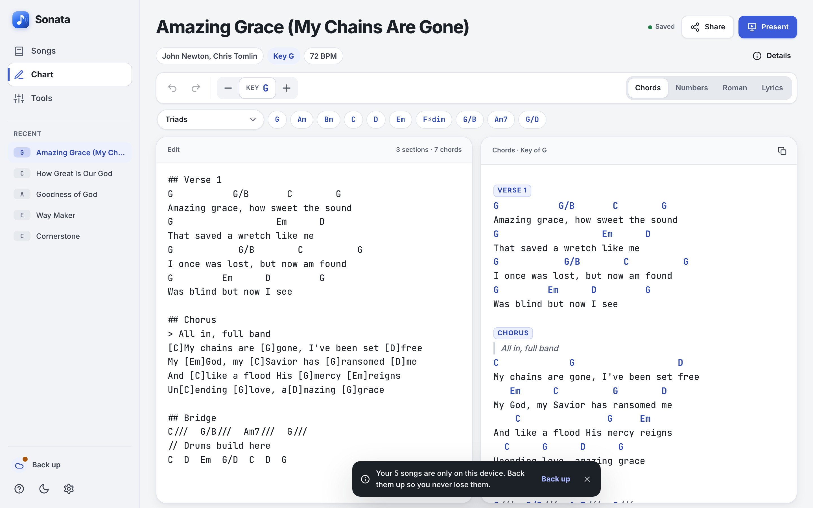

| Tools Hub | Minor Circle & Key Finder | Stage view | Share & export |
| :---: | :---: | :---: | :---: |
| 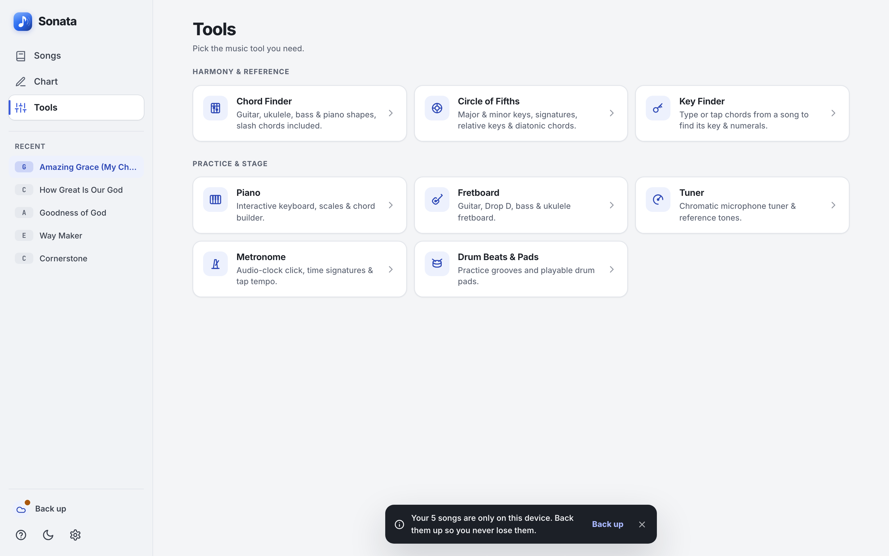 | 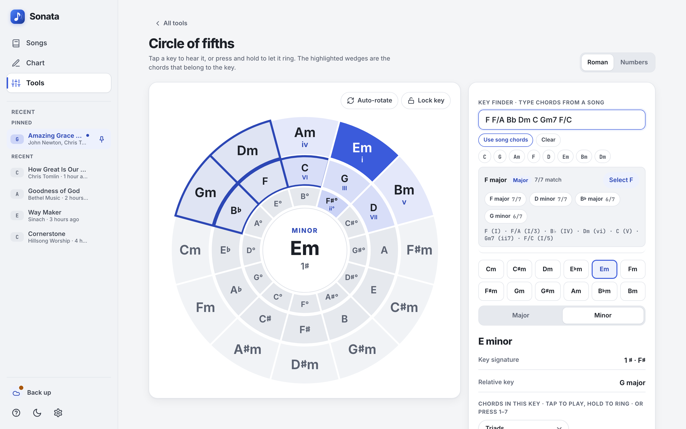 | 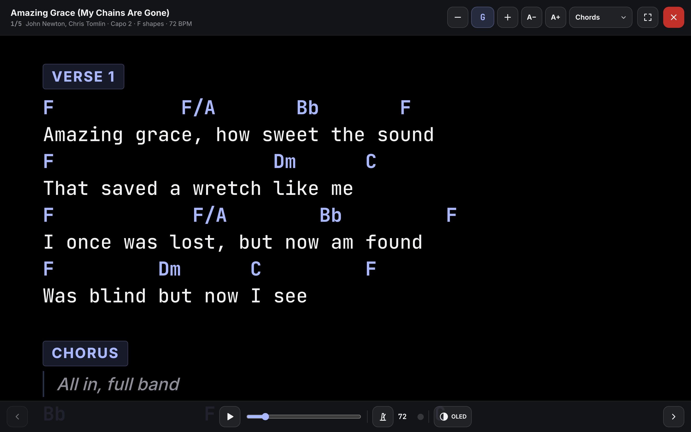 | 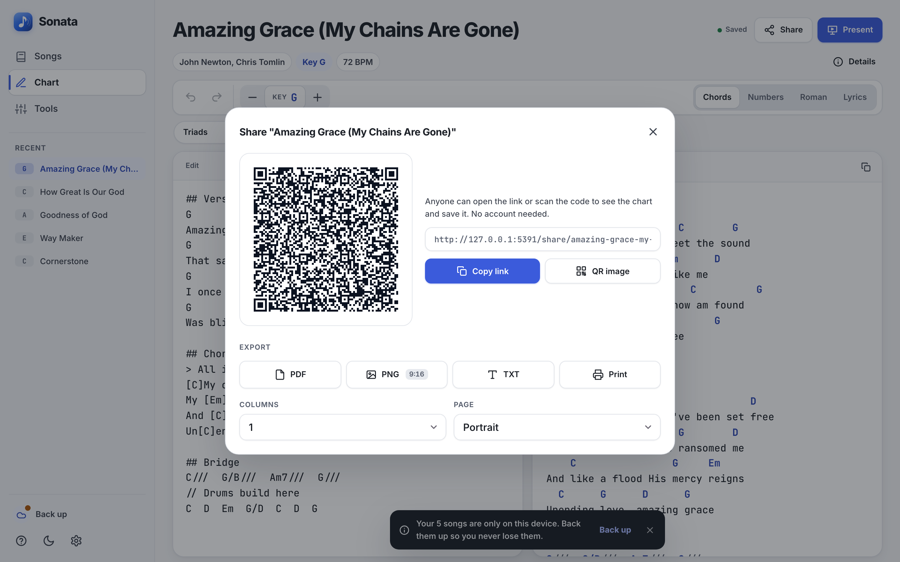 |

| Phone chart | Phone Tools Hub | Phone piano | Metronome | Songs (dark) |
| :---: | :---: | :---: | :---: | :---: |
| 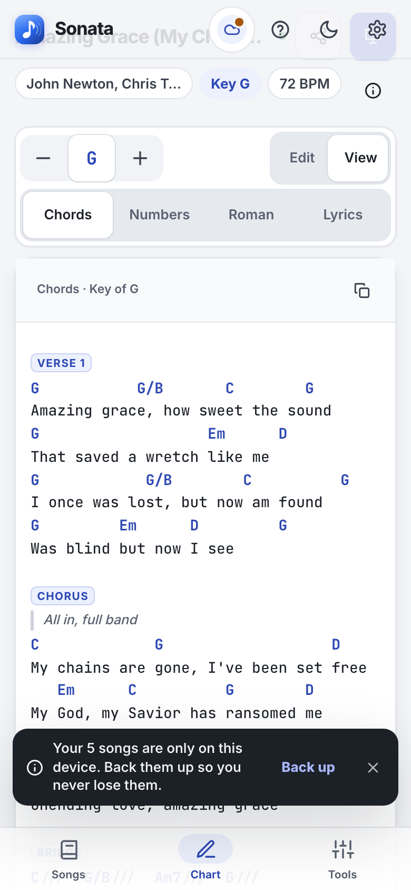 | 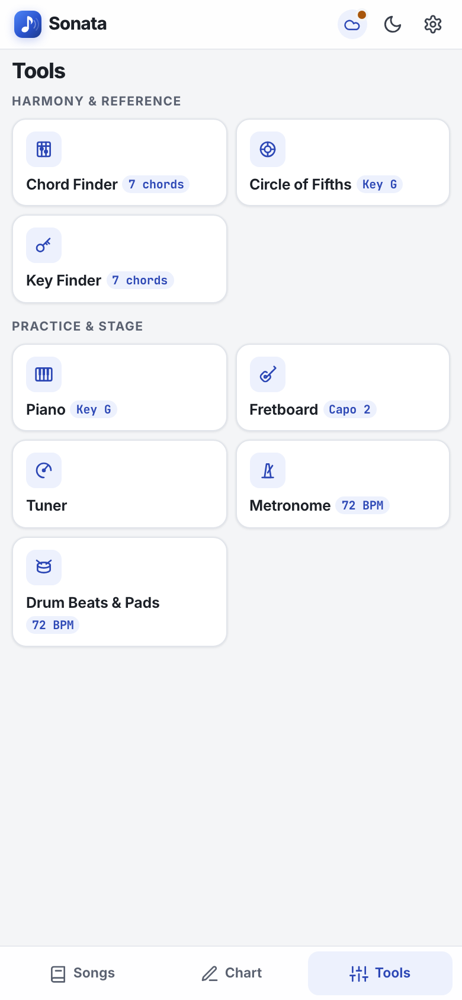 | 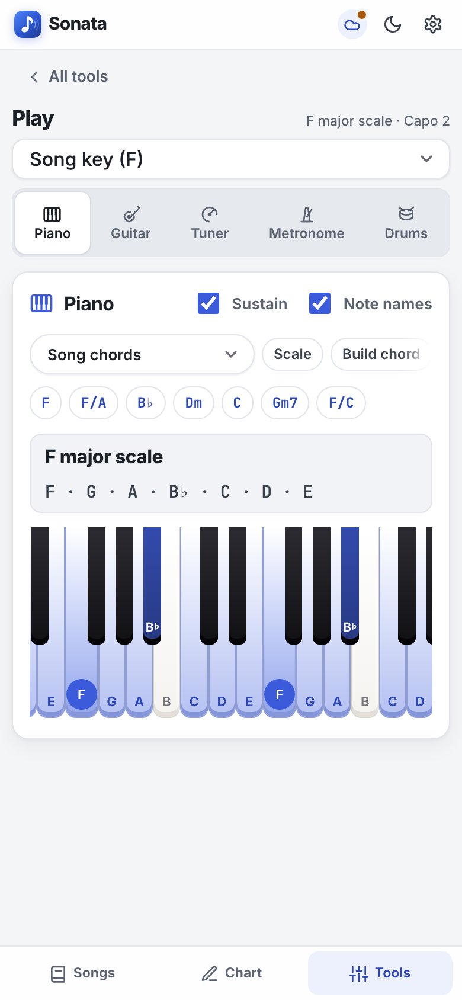 | 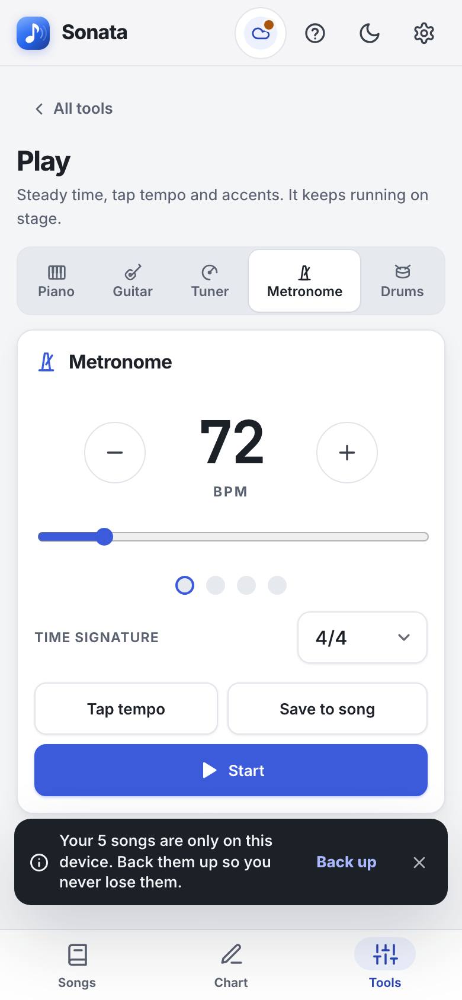 | 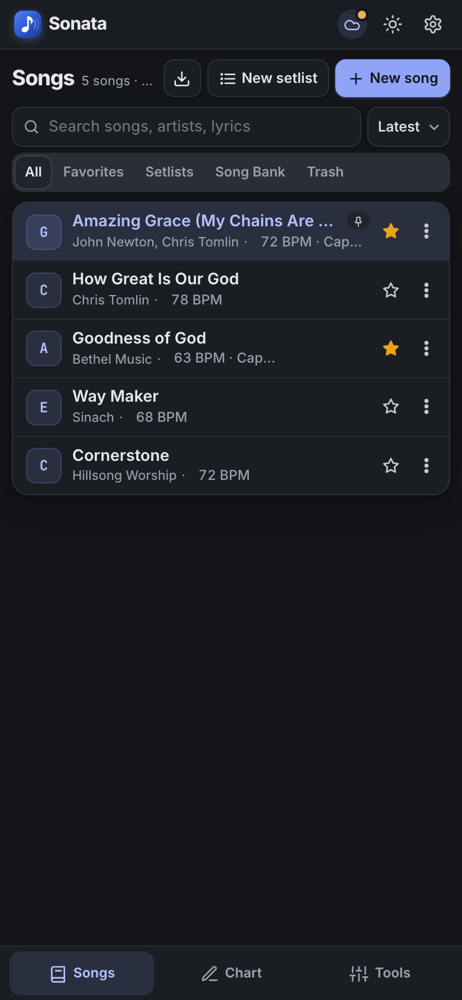 |

| Chords | Songs + chart | Song Bank | Phone chords | Phone Song Bank |
| :---: | :---: | :---: | :---: | :---: |
| 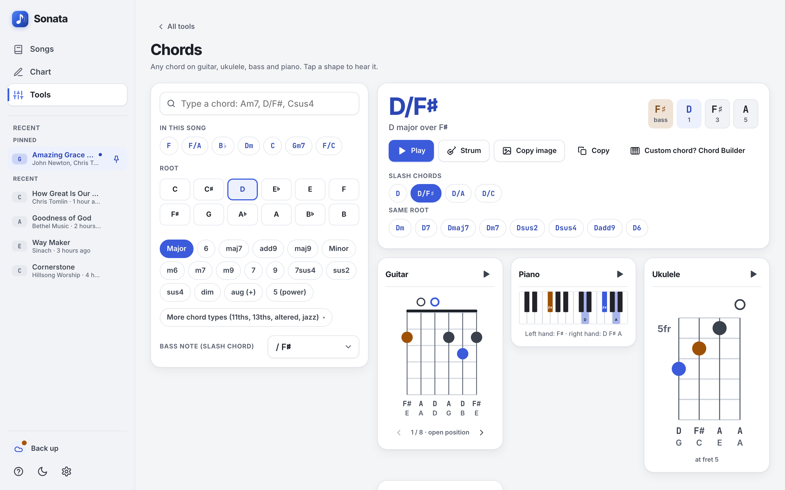 | 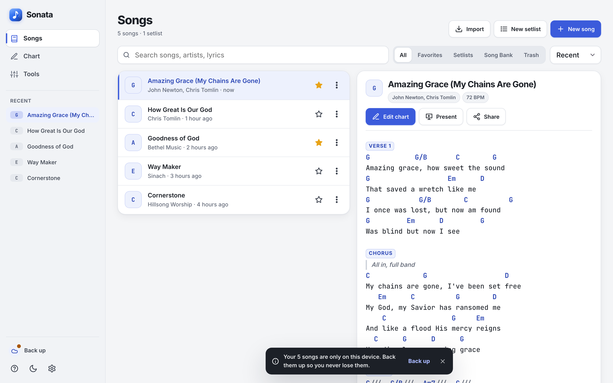 | 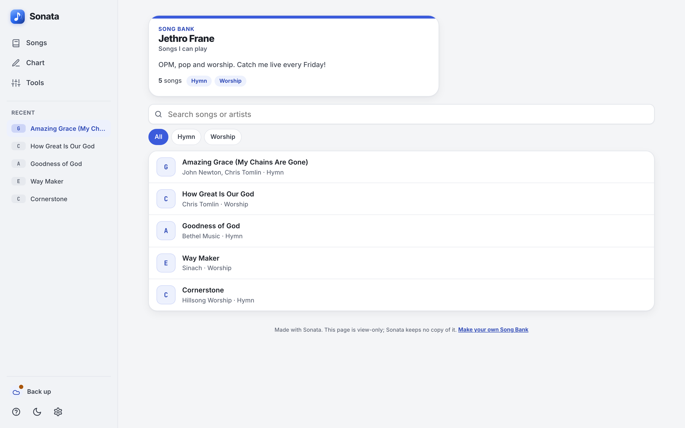 | 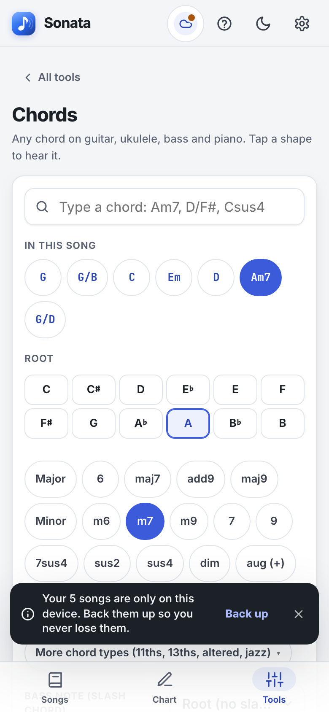 | 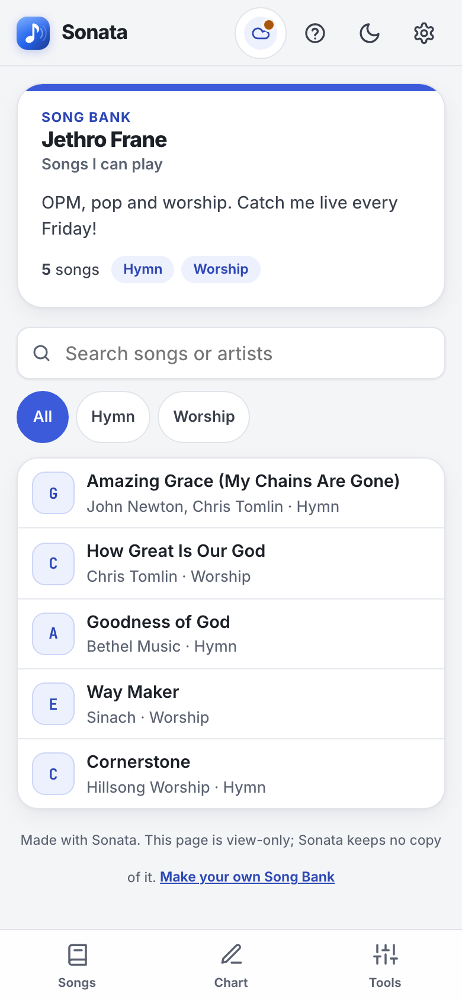 |

## What it does

Three clean tabs (**Songs · Chart · Tools**), plus a public Song Bank and built-in AI Agent / MCP tools:

- **Songs**: **Import** a chart from a link to a chord page, pasted chords, a `.txt`/ChordPro file or Sonata links; search titles, artists and lyrics; favorites; setlists you reorder and play in order, and **Add to setlist** from any song's menu. On a phone a song opens ready to read (View); Edit is one tap away. On a computer, recent songs stay in the sidebar.
  - **30-day Trash**: deleting a song or setlist moves it to **Trash** for 30 days (synced with Google Drive) with an immediate Undo toast. Restoring a song brings it back to your library and its original setlists; *Delete forever* and *Empty trash* ask for confirmation first.
  - **Song Bank**: the songs you know or offer, with genres, your name, a short note, your own colors and upcoming gigs. Publish, then share the link. The page is view-only: people search and read a chart in their key.
- **Chart**: chords above the lyrics or inline (`[G]Amazing`). Chords stay over the right word even when a line wraps on a phone. Chord chips insert at the cursor. Autosave, undo and redo per song.
  - **Key button**: transpose, song key, capo (shows the shapes you actually play), sharps or flats, and *Write into chart* to make the new key permanent.
  - **Views**: Chords, Nashville numbers, Roman numerals, or lyrics only.
  - **Present**: big stage text, auto-scroll that pauses when you touch, setlist navigation, page-turner pedals (Page Down/Up: one screen per press, then the next song), metronome, three stage colors, screen stays awake, optional full screen on a computer.
  - **Live setlist link**: publish a setlist once from your own Google Drive; the band's link always shows the latest version, and each player keeps their own key and capo. No accounts.
  - **Share**: a link or QR code that carries the song itself, plus PDF (whole setlists too), PNG (9:16, phone-sized, previewed first, with Copy image), TXT and print in the same sheet. Old Sonata links still open.
- **Tools** (`/tools`): a calm, dedicated Tools Hub grouping Harmony & Reference and Practice & Stage tools, each with a `← All tools` back pill:
  - **Chord Finder** (`/chords`): type or pick any chord (slash chords too: `Am7/G`, `D/F#`) and see it on guitar and ukulele (every playable shape, the chord-book one first), bass (where its notes are) and piano. Tap a chord in a chart for the same view. Links like `/chords/Am7` open straight to it.
  - **Circle of Fifths** (`/theory`): explore Major and Minor keys with the key family highlighted, Roman/Nashville numerals on each wedge, key signature, relative key, and the chords of the key to tap or press-and-hold to sustain. Switching to **Minor** rearranges the circle itself so Minor keys occupy the primary outer ring (`Am` at 12 o'clock) and Relative Major keys sit on the inner ring.
  - **Key Finder** (`/tools/key-finder`): type or tap chords—or pull the active song's chords in one tap—to compare the top matching Major and Minor key candidates with match counts, see the progression with Roman or Nashville numerals, and light up your song's chords directly on the Circle of Fifths.
  - **Practice & Stage** (`/play/piano`, `/play/guitar`, `/play/tuner`, `/play/metronome`, `/play/drums`): interactive piano (with chord builder & sustain), fretboard (guitar, Drop D, 4- and 5-string bass, ukulele), chromatic microphone tuner with reference tones, audio-clock metronome (2/4 to 12/8, tap tempo, save tempo to a song), and drum grooves + playable pads.

Instrument sounds are saved on the device the first time they are played (or all at once from Settings), so Play works offline. Every dropdown across the app opens as an anchored floating popover menu with keyboard navigation (`ArrowDown`/`ArrowUp`, `Home`/`End`, `Enter`, `Escape`) without shifting the layout.

**AI Agents & MCP** (Settings → AI Agents & MCP, or Back up → AI Agents & MCP):
- **Browser WebMCP & JS Bridge**: registers 17 tools with `navigator.modelContext` and exposes `window.sonataAgent` (`tools()`, `call(name, args)`, `guide`) for in-browser AI assistants.
- **Remote MCP Server** (`https://sonata.jethrofrane.xyz/api/mcp`): Streamable HTTP JSON-RPC 2.0 server providing 6 public music & chart tools anonymously (`extract_chords_from_url`, `analyze_chord_chart`, `build_sonata_link`, `lookup_chord`, `transpose_chart`, `get_key_info`) and all 17 tools (including library & setlist CRUD + 30-day Trash safety) when authenticated via Google Drive OAuth 2.1 + PKCE (`/.well-known/oauth-protected-resource`, `/.well-known/oauth-authorization-server`).
- **Local CLI & stdio MCP** (`scripts/sonata-cli.mjs`): run `node scripts/sonata-cli.mjs tools|guide|call|mcp` locally or pair with `gdrive` via the `sonata-controller` skill. See [docs/mcp-connect.md](docs/mcp-connect.md).

**Backup & restore** (the Back up button): one sheet that says whether your songs are safe. Google Drive backup to one file only Sonata can see (`sonata_library.json`), a one-tap backup file with a checksum (on a phone it opens the share sheet), restore from a file, and **earlier versions**: a copy of the library is kept on the device when the app opens after changes (the last 15) and before every restore.

**Help** (the ? button, or the ? key): a one-minute guided tour offered on a first visit, tips for the screen that is open, and short answers to common questions.

Also: English and Filipino; a clean light theme and a soft charcoal dark theme (no pure black or pure white, easy on the eyes in a dark room).

## Writing a chart

```
## Verse 1
G           G/B       C        G
Amazing grace, how sweet the sound
[C]My chains are [G]gone
> Band note (never transposed)
C///  G/B///      rhythm slashes
Intro: G  C6/9  D  (x2)   labels and repeat marks stay on a chord line
---               divider
```

## Privacy and security

- Songs are stored in your browser. Nothing leaves the device unless you turn on Drive backup, share a link, publish a Song Bank, or connect an OAuth-authorized MCP client to your Drive file.
- Import reads one page you paste through the `/api/import` function: public https pages only, no cookies, size and time limits, and only the chart text comes back. Nothing is kept.
- No Sonata database. Share links and QR codes carry the song itself. A Song Bank is one file in the owner's own Google Drive, shared "anyone with the link can view"; the `/api/bank` function reads it when someone opens the list and keeps nothing. A live setlist works the same way through `/api/set`. Remote MCP OAuth tokens seal your Google Drive tokens with AES-256-GCM so Sonata never stores credentials on a server.
- Vercel Web Analytics counts anonymous page views (no cookies). No ads, no trackers.
- Strict Content Security Policy (scripts only from this site and Google sign-in, no inline handlers), HSTS, no inline scripts, fonts served from this site.
- Backup files are checked before anything is restored (size, shape, checksum), a restore point is kept first, and a restore never deletes songs.
- The import and MCP URL functions allow a short burst of requests per address, then ask it to wait.
- Share links are size-capped and decompressed with a limit, so a crafted link can't freeze the app or the link-preview function. Song links only open as normal `http(s)` links.

## How it's built

A small, framework-free app: plain JavaScript modules typed with JSDoc (checked by TypeScript), bundled by [Vite](https://vite.dev) and made offline-ready by [Workbox](https://developer.chrome.com/docs/workbox) through `vite-plugin-pwa`.

```
index.html             every screen (Songs, Chart, Tools Hub + tool views), the stage and one dialog
css/                   tokens, base controls, shell, views, lazy music tools, lazy backup/help, overlays
js/main.js             start-up, 3-tab routing, service worker; loads each tool screen on first use
js/router.js           URL for every screen and song (/tools, /tools/key-finder, /song/<slug>/stage…)
js/core/               music theory, chart layout, storage + 30-day Trash, share links, pitch detection,
                       isomorphic MCP tool definitions (mcp-tools.js)
js/agent.js            lazy WebMCP (navigator.modelContext) & window.sonataAgent browser bridge
js/lib/                QR codes and PDF/PNG export (loaded only when used)
js/ui/                 the views. Songs, Chart and Tools Hub start with the app; Chords, Theory, Play,
                       Stage, Song Bank, the dialogs, Backup and Help load on demand
js/audio.js            piano, plucked strings, metronome (loaded with the first screen that makes sound)
js/drive.js            Google Drive backup (loaded for people who use it)
js/core/snapshots.js   earlier versions of the library, kept on the device (IndexedDB)
js/core/backupfile.js  backup files: build, checksum, check before restore
api/                   link previews (page.js), chord import (import.js), Song Bank (bank.js),
                       live setlists (set.js), Remote MCP (mcp.js) & OAuth 2.1 (oauth.js + _lib/)
scripts/sonata-cli.mjs local CLI and stdio JSON-RPC 2.0 MCP server for sonata_library.json
public/                icons, manifest, release notes, screenshots, boot.js (theme before first paint)
```

- **Fast start**: first-load JS is ~42.5 KB gzipped and first-load CSS is ~16.4 KB gzipped; hashed files are cached for a year, the page itself always revalidates.
- **Offline**: core app assets precache on first visit. New versions show a *Reload* prompt instead of swapping silently mid-song.
- **Install**: web app manifest with home-screen shortcuts (New song, Metronome, Tuner, Theory) and install screenshots.

## Development

Needs Node 20+.

```
npm install
npm run dev            # http://localhost:5391 with hot reload
npm test               # unit + API/MCP/OAuth tests
npm run typecheck      # TypeScript checks the JavaScript
npm run build          # production build in dist/
npm run check          # tests + typecheck + build + bundle size budget check
npm run serve:dist     # serve dist/ the way production does (routes fall back to index.html)
BASE=http://127.0.0.1:5391/ node tests/browser.e2e.mjs      # browser tests (Playwright)
BASE=http://127.0.0.1:5391/ node tests/routes.e2e.mjs       # routes, Tools Hub, layout and overflow checks
BASE=http://127.0.0.1:5391/ node tests/trash-agent.e2e.mjs  # Trash, WebMCP/agent, v7 nav, dropdowns & Minor Circle
npm run test:a11y && npm run test:regression                # axe checks; fixed-bug checks (fake Drive included)
OUT=/tmp/sonata-audit npm run test:audit                    # screens × sizes: screenshots, overflow, 44px targets, axe
BASE=http://127.0.0.1:5391 node tests/screenshots.mjs       # refresh the screenshots above
```

Release notes live in `public/update_log.json` and show in the app under Settings → About. Bump `package.json` and `public/version.json` with each release. Pushes to `main` deploy to Vercel, and the only public address is https://sonata.jethrofrane.xyz (no GitHub Pages, no `*.vercel.app` alias).

Data formats are stable: songs, setlists, 30-day trash and settings stay under the `sonata:v12:*` storage keys, and `?s=` share links keep the v1/v4 format, so older libraries and links keep working.

Made by Jethro Frane. *"So whether you eat or drink or whatever you do, do it all for the glory of God."* (1 Corinthians 10:31)
