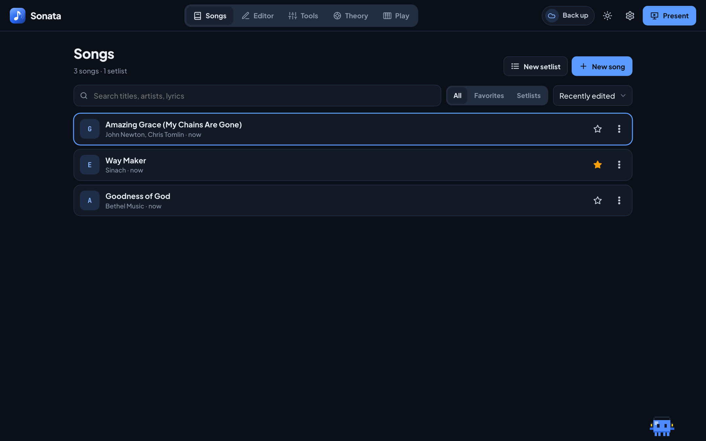
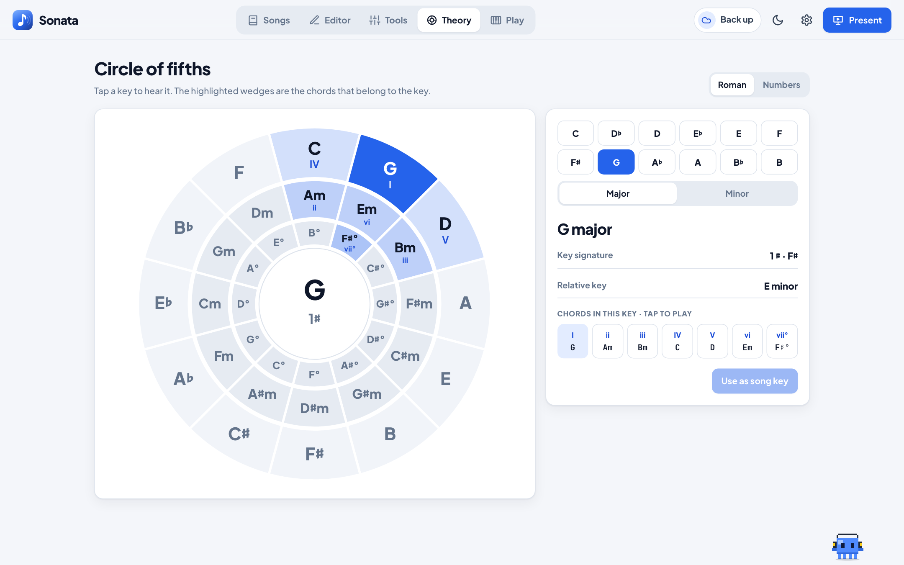
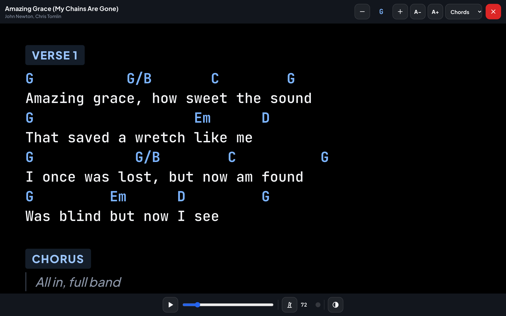
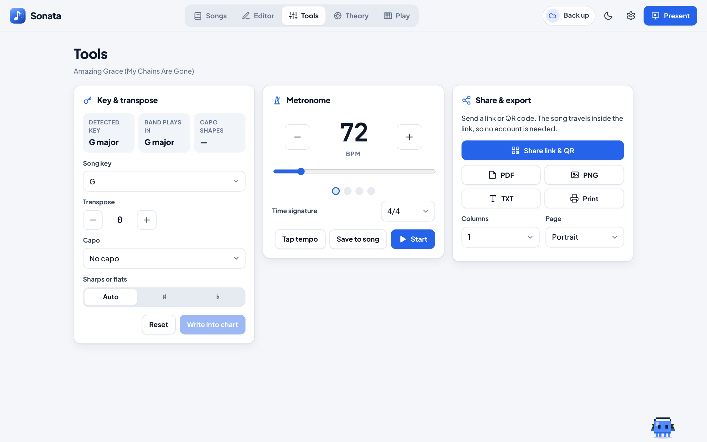
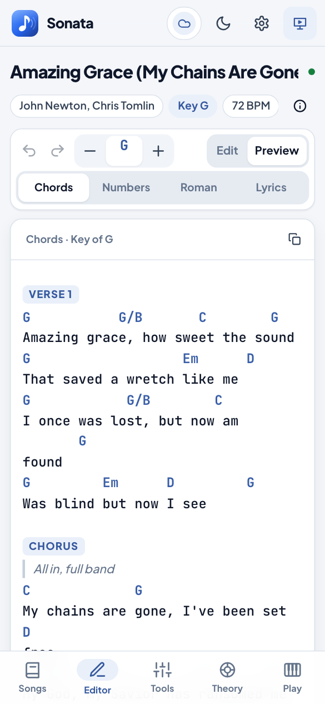

# Sonata

Chord charts and music tools for musicians and worship teams. Write a chart, transpose it for your singer, put it on stage, and share it with the band. Free, no account needed, and it works offline.

**Live:** https://sonata.jethrofrane.xyz


| Songs (dark) | Circle of fifths | Piano, fretboard & tuner |
| :---: | :---: | :---: |
|  |  |  |

| Stage view | Tools | Phone |
| :---: | :---: | :---: |
|  |  |  |

## What it does

- **Editor**: chords above the lyrics or inline (`[G]Amazing`). Chords stay over the right word even when a line wraps on a phone. Chord chips insert chords at the cursor. Everything autosaves; undo and redo work per song.
- **Views**: Chords, Nashville numbers, Roman numerals, or lyrics only.
- **Key, transpose and capo** are saved per song. With a capo, Sonata shows the shapes you actually play.
- **Stage view**: big text, auto-scroll that pauses when you touch, setlist navigation, metronome, three stage colors, and the screen stays awake.
- **Songs and setlists**: search titles, artists and lyrics; favorites; setlists you can reorder and play in order.
- **Theory**: circle of fifths with the key family highlighted, numbers on each wedge, key signature, relative key, and the seven chords of the key to tap and hear.
- **Play**: piano and fretboard (guitar, Drop D, 4- and 5-string bass, ukulele) showing a scale or any chord from your song; chromatic tuner; reference tones.
- **Metronome**: steady timing on the audio clock, 2/4 to 12/8, tap tempo, save tempo to a song.
- **Share**: a link or QR code that carries the song itself. Old Sonata links still open.
- **Export**: PDF (whole setlists too), PNG, TXT, print.
- **Backup**: optional Google Drive sync to one file only Sonata can see (`sonata_library.json`), plus backup files you can export and import.
- **Sona**: a small blue pixel musician who wanders the bottom of the screen and shares tips. Hide Sona in Settings.
- English and Filipino.

## Writing a chart

```
## Verse 1
G           G/B       C        G
Amazing grace, how sweet the sound
[C]My chains are [G]gone
> Band note (never transposed)
C///  G/B///      rhythm slashes
---               divider
```

## Privacy

Songs are stored in your browser. Nothing is sent anywhere unless you turn on Drive backup, share a link, or choose to shorten a link with TinyURL. Vercel Web Analytics counts anonymous page views (no cookies). No ads.

## Development

Plain HTML, CSS and JavaScript modules. There is no build step: the files are served as they are.

```
css/app.css          all styles
js/main.js           start-up and view switching
js/core/             music theory, chart layout, storage, share links, pitch detection (no DOM, unit-tested)
js/lib/              QR codes and PDF/PNG export
js/ui/               the views: editor, library, tools, theory, play, tuner, stage, sheets, Sona
js/audio.js          piano, plucked strings, metronome
js/drive.js          Google Drive backup
sw.js                offline cache
```

```
npm start              # serve at http://localhost:5391
npm test               # unit tests (Node 20+)
npm run typecheck      # TypeScript checks the JavaScript (JSDoc types)
npm run test:browser   # browser tests (needs Playwright)
```

Release notes live in `update_log.json` and show in the app under Settings → About. Deploys go out from `main` on Vercel.

Made by Jethro Frane. *"So whether you eat or drink or whatever you do, do it all for the glory of God."* (1 Corinthians 10:31)
