# Sonata

Chord charts and music tools for every musician: gigs, practice, lessons and church. Write a chart, transpose it for your singer, put it on stage, and share it with the band. Free, no account, works offline, installs like an app.

**Live:** https://sonata.jethrofrane.xyz

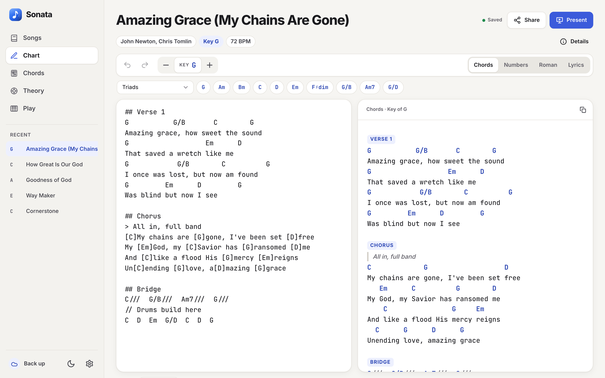

| Stage view | Share & export | Circle of fifths |
| :---: | :---: | :---: |
| 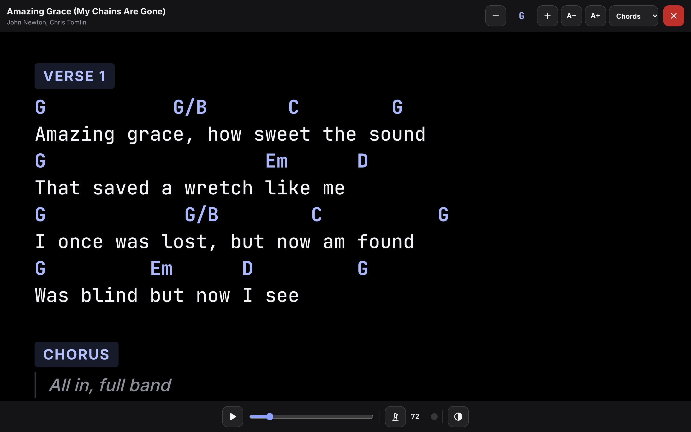 | 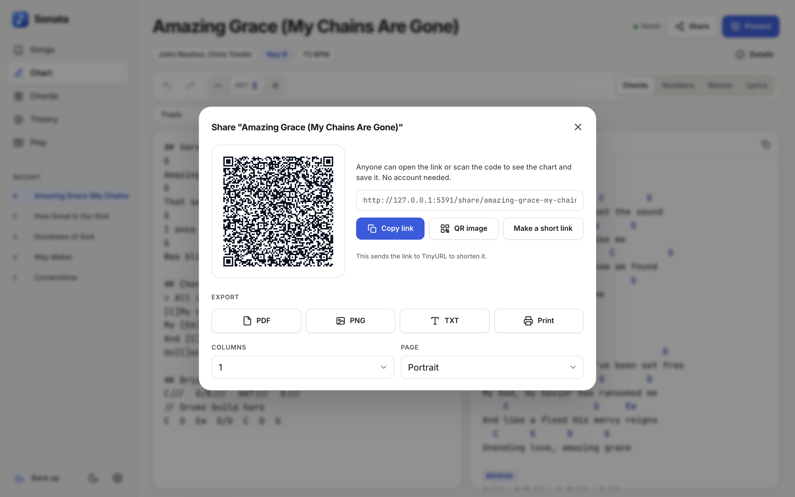 | 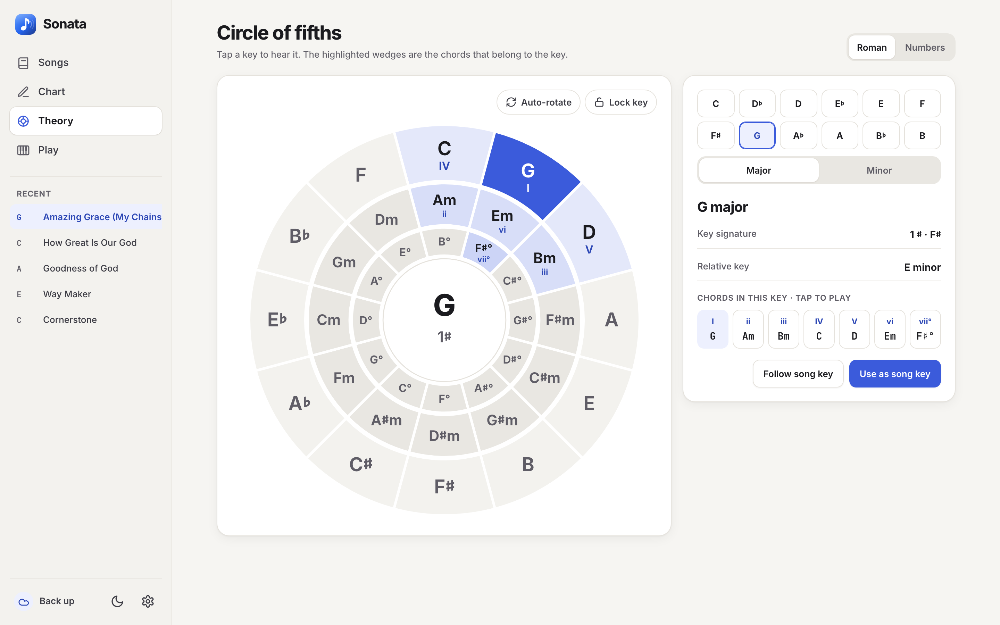 |

| Phone chart | Phone piano | Metronome | Songs (dark) |
| :---: | :---: | :---: | :---: |
| 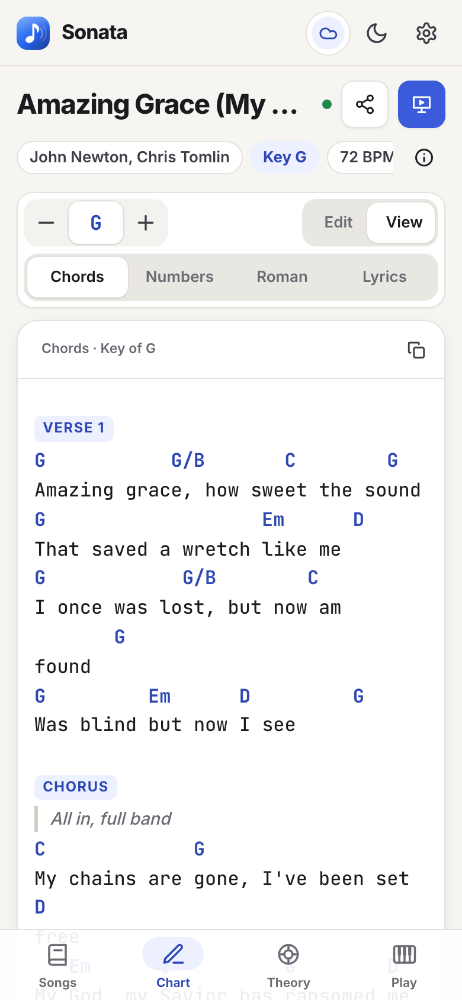 | 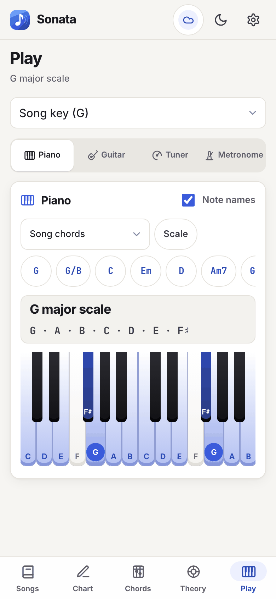 | 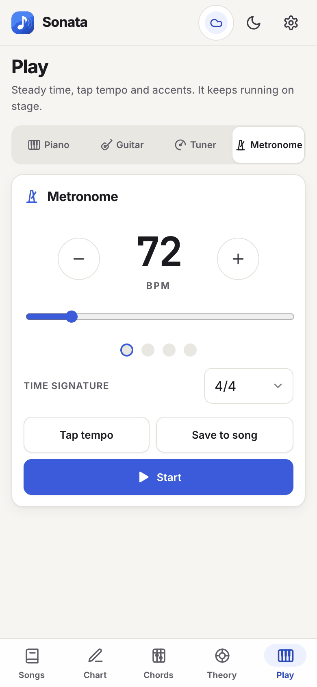 | 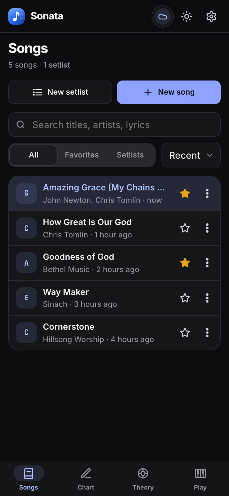 |

| Chords | Songs + chart | Song Bank | Phone chords | Phone Song Bank |
| :---: | :---: | :---: | :---: | :---: |
| 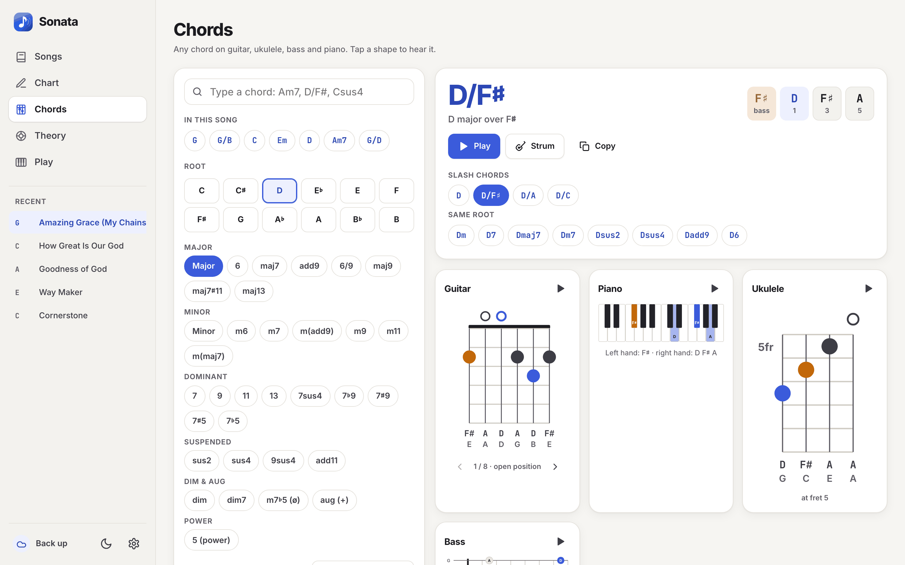 | 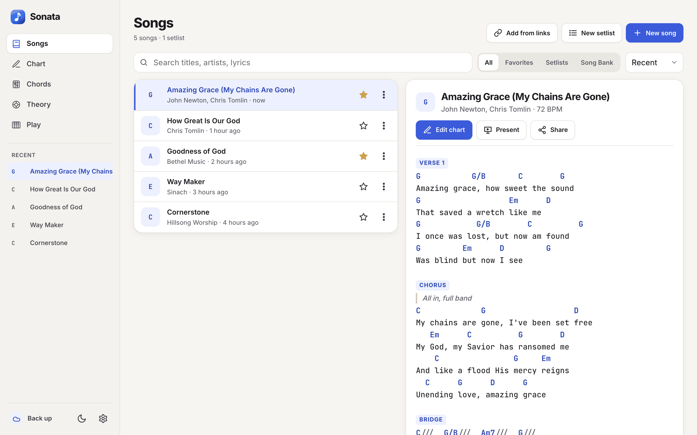 | 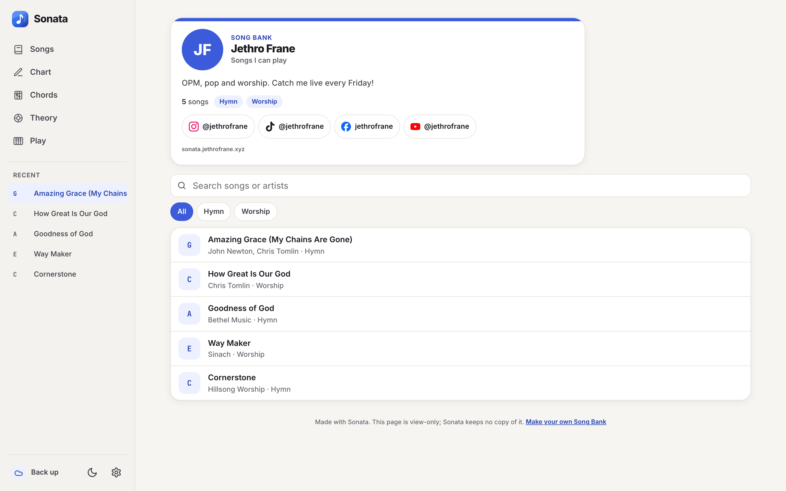 | 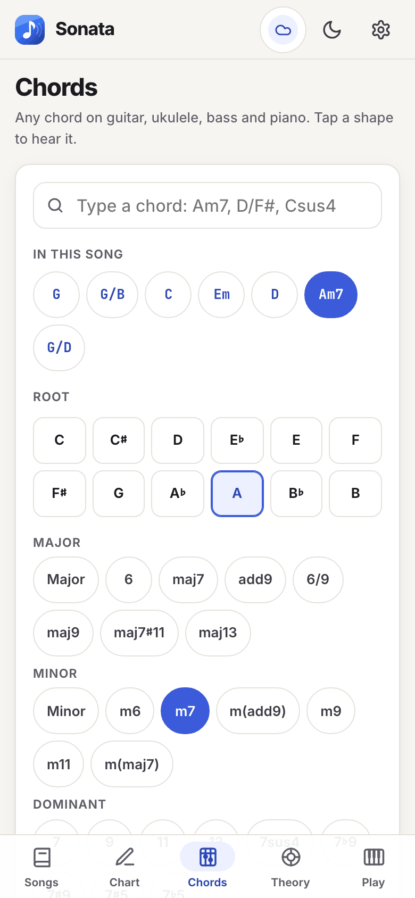 | 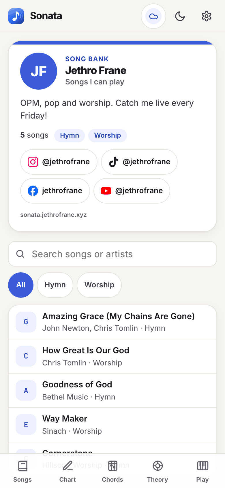 |

## What it does

Five places, one job each, plus a Song Bank:

- **Songs**: **Import** a chart from a link to a chord page, pasted chords, a `.txt`/ChordPro file or Sonata links; search titles, artists and lyrics; favorites; setlists you reorder and play in order. On a computer, recent songs stay in the sidebar.
- **Chart**: chords above the lyrics or inline (`[G]Amazing`). Chords stay over the right word even when a line wraps on a phone. Chord chips insert at the cursor. Autosave, undo and redo per song.
  - **Key button**: transpose, song key, capo (shows the shapes you actually play), sharps or flats, and *Write into chart* to make the new key permanent.
  - **Views**: Chords, Nashville numbers, Roman numerals, or lyrics only.
  - **Present**: big stage text, auto-scroll that pauses when you touch, setlist navigation, metronome, three stage colors, screen stays awake, optional full screen on a computer.
  - **Live setlist link**: publish a setlist once from your own Google Drive; the band's link always shows the latest version, and each player keeps their own key and capo. No accounts.
  - **Share**: a link or QR code that carries the song itself, plus PDF (whole setlists too), PNG (previewed first, with Copy image), TXT and print in the same sheet. Old Sonata links still open.
- **Chords**: type or pick any chord (slash chords too: `Am7/G`, `D/F#`) and see it on guitar and ukulele (every playable shape, the chord-book one first), bass (where its notes are) and piano. Tap a chord in a chart for the same view. Links like `/chords/Am7` open straight to it.
- **Song Bank**: the songs you know or offer, with genres, your name, a short note, your own colors and upcoming gigs. Publish, then share the link. The page is view-only: people search and read a chart in their key.
- **Theory**: circle of fifths with the key family highlighted, numbers on each wedge, key signature, relative key, and the seven chords of the key to tap and hear.
- **Play**: piano, fretboard (guitar, Drop D, 4- and 5-string bass, ukulele), chromatic tuner with reference tones, and a metronome on the audio clock (2/4 to 12/8, tap tempo, save tempo to a song).

Instrument sounds are saved on the device the first time they are played (or all at once from Settings), so Play works offline.

**Backup & restore** (the Back up button): one sheet that says whether your songs are safe. Google Drive backup to one file only Sonata can see (`sonata_library.json`), a one-tap backup file with a checksum (on a phone it opens the share sheet), restore from a file, and **earlier versions**: a copy of the library is kept on the device when the app opens after changes (the last 15) and before every restore.

**Help** (the ? button, or the ? key): a one-minute guided tour offered on a first visit, tips for the screen that is open, and short answers to common questions.

Also: English and Filipino, light and dark themes.

## Writing a chart

```
## Verse 1
G           G/B       C        G
Amazing grace, how sweet the sound
[C]My chains are [G]gone
> Band note (never transposed)
C///  G/B///      rhythm slashes
Intro: G  C6/9  D  (x2)   labels and repeat marks stay on a chord line
---               divider
```

## Privacy and security

- Songs are stored in your browser. Nothing leaves the device unless you turn on Drive backup, share a link, publish a Song Bank.
- Import reads one page you paste through the `/api/import` function: public https pages only, no cookies, size and time limits, and only the chart text comes back. Nothing is kept.
- No Sonata database. Share links and QR codes carry the song itself. A Song Bank is one file in the owner's own Google Drive, shared "anyone with the link can view"; the `/api/bank` function reads it when someone opens the list and keeps nothing. A live setlist works the same way through `/api/set`. There is no request inbox, so there is nothing to spam; payment codes are shown exactly as the owner uploaded them, with the name written inside the code so visitors can check it.
- Vercel Web Analytics counts anonymous page views (no cookies). No ads, no trackers.
- Strict Content Security Policy (scripts only from this site and Google sign-in, no inline handlers), HSTS, no inline scripts, fonts served from this site.
- Backup files are checked before anything is restored (size, shape, checksum), a restore point is kept first, and a restore never deletes songs.
- The import function allows a short burst of requests per address, then asks it to wait.
- Share links are size-capped and decompressed with a limit, so a crafted link can't freeze the app or the link-preview function. Song links only open as normal `http(s)` links.

## How it's built

A small, framework-free app: plain JavaScript modules typed with JSDoc (checked by TypeScript), bundled by [Vite](https://vite.dev) and made offline-ready by [Workbox](https://developer.chrome.com/docs/workbox) through `vite-plugin-pwa`.

```
index.html             every screen, the stage and one dialog
css/                   tokens, base controls, shell, views, music tools, overlays
js/main.js             start-up, routing, service worker; loads each screen the first time it opens
js/router.js           URL for every screen and song (/song/<slug>/stage, /play/metronome…)
js/core/               music theory, chart layout, storage, share links, pitch detection (no DOM, unit-tested)
js/lib/                QR codes and PDF/PNG export (loaded only when used)
js/ui/                 the views. Songs and Chart start with the app; Chords, Theory, Play, Stage,
                       Song Bank, the dialogs, Backup and Help are separate chunks loaded on first use
js/audio.js            piano, plucked strings, metronome (loaded with the first screen that makes sound)
js/drive.js            Google Drive backup (loaded for people who use it)
js/core/snapshots.js   earlier versions of the library, kept on the device (IndexedDB)
js/core/backupfile.js  backup files: build, checksum, check before restore
api/page.js            link previews: per-page and per-shared-song titles for chat apps
public/                icons, manifest, release notes, screenshots, boot.js (theme before first paint)
```

- **Fast start**: one hashed JS file (~54 KB gzipped) and one CSS file; hashed files are cached for a year, the page itself always revalidates.
- **Offline**: about 410 KB is stored on first visit. New versions show a *Reload* prompt instead of swapping silently mid-song.
- **Install**: web app manifest with home-screen shortcuts (New song, Metronome, Tuner, Theory) and install screenshots.

## Development

Needs Node 20+.

```
npm install
npm run dev            # http://localhost:5391 with hot reload
npm test               # unit tests
npm run typecheck      # TypeScript checks the JavaScript
npm run build          # production build in dist/
npm run serve:dist     # serve dist/ like Vercel does (routes fall back to index.html)
BASE=http://127.0.0.1:5391/ node tests/browser.e2e.mjs   # browser tests (Playwright)
BASE=http://127.0.0.1:5391/ node tests/routes.e2e.mjs    # routes, layout and overflow checks
npm run test:a11y && npm run test:regression             # axe checks; fixed-bug checks (fake Drive included)
OUT=/tmp/sonata-audit npm run test:audit                 # 25 screens × 6 sizes: screenshots, overflow, 44px targets, axe
BASE=http://127.0.0.1:5391 node tests/screenshots.mjs    # refresh the screenshots above
```

Release notes live in `public/update_log.json` and show in the app under Settings → About. Bump `package.json` and `public/version.json` with each release. Pushes to `main` deploy on Vercel.

Data formats are stable: songs and settings stay under the `sonata:v12:*` storage keys, and `?s=` share links keep the v1 format, so older libraries and links keep working.

Made by Jethro Frane. *"So whether you eat or drink or whatever you do, do it all for the glory of God."* (1 Corinthians 10:31)
